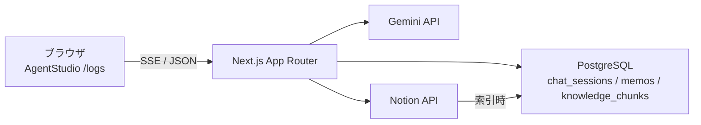
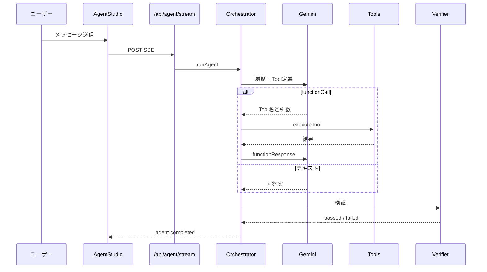
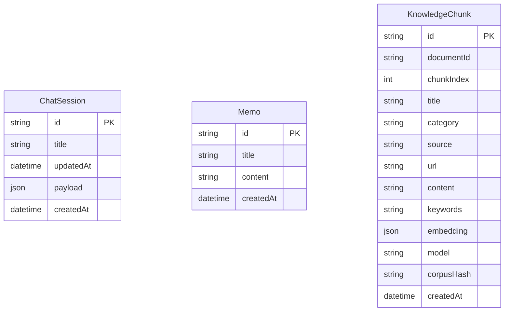

# MY HERO AGENT 設計書

最終更新: 2026-11-15

このページはアプリの設計正本です。実装を変えたら `docs/design.md` を直し、`npm run docs:sync` で社内ナレッジ Notion へ反映します。次回の `searchKnowledge` で再インデックスされます。

## 1. 機能概要

MY HERO AGENT は、チャットから社内 Notion を検索・作成し、計算やメモも行う Web エージェントです。

- チャット UI（履歴・Execution Trace・データログ）
- Gemini の function calling で Tool を選択・実行
- Verifier が最終回答を点検
- RAG: 社内ナレッジ Notion DB だけをチャンクして PostgreSQL に埋め込み
- Notion へのページ作成・追記・DB プロパティ追加/削除
- 会話セッションとメモは PostgreSQL

## 2. システム構成

主なコード:

- UI: `src/components/AgentStudio.tsx`
- 実行: `src/lib/agent/orchestrator.ts` / `src/lib/agent/verifier.ts`
- Tool: `src/lib/tools/registry.ts`
- RAG: `src/lib/knowledge/`
- 永続化: `src/lib/store/db.ts` / Prisma

## 3. 処理フロー

1. ユーザー入力を `chat_sessions.payload.messages` に積む
2. Gemini が Tool を選ぶ（キー無しはデモプラン）
3. 許可リストの Tool だけ実行し、結果をモデルへ返す（最大 10 ラウンド）
4. Verifier が不合格なら一度だけ書き直し
5. SSE と `ioLogs` に入出力を残す

## 4. ER図

Prisma 上のテーブル。外部キーは無く、会話本文は JSON にまとめる。

`payload` の主なキー: `messages`, `traces`, `toolExecutions`, `eventLog`, `ioLogs`, `lastAnswer`, `verification`

## 5. 画面

- `/` チャット。左履歴、中央会話、右 Execution Trace
- `/logs` データログ。処理の流れ / 会話の IN-OUT / チャンク / メモ

## 6. API

- `POST /api/agent/stream` SSE でエージェント実行
- `POST /api/agent/run` 同期実行
- `GET /api/sessions` 会話一覧
- `GET /api/sessions/:id` 会話全文
- `GET|POST /api/memos` / `DELETE /api/memos/:id`
- `GET /api/inspect` データログ用スナップショット
- `GET /api/tools` Tool 定義

## 7. Tools

| 名前 | 役割 |
| --- | --- |
| searchKnowledge | 社内ナレッジ RAG（読み取り） |
| answerQuestion | 一般事実。Gemini 検索 |
| calculate | 四則演算 |
| saveMemo | アプリ内メモ |
| listNotionPages / listNotionDatabases | 一覧 |
| createNotionPage / appendNotionPage | ページ作成・追記。Markdown（太字・コードブロック等） |
| addNotionDatabaseProperty / removeNotionDatabaseProperty | DB 列の追加・削除 |

RAG 対象は環境変数 `NOTION_DATABASE_ID` のデータベースのみ。新規に作った別 DB は、明示しない限り検索対象にしない。

## 8. RAG 詳細

1. Notion から本文取得
2. チャンク化して embedding（`gemini-embedding-001`）。キーが無ければ語句検索のみ
3. `knowledge_chunks` に保存。`corpusHash` が同じなら再埋め込みしない
4. 検索はコサイン類似度 + 日本語の語句スコア

設計を変えたあとは Notion の `last_edited_time` が変わるため、次の検索で再インデックスされる。

## 9. 環境

- `GEMINI_API_KEY` / `GEMINI_MODEL`
- `NOTION_TOKEN` / `NOTION_DATABASE_ID`
- `DATABASE_URL`（本番は Prisma Postgres。接頭辞 `AI_AGENT_*` も可）

## 10. 詳細設計の置き場

機能を足したら、この文書の該当節と上の図を更新する。個別の実装はコードを正とし、この文書は責務とデータの流れを書く。
